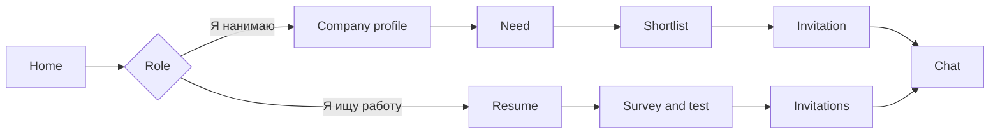

# Product overview

**Normative requirements:** [BRD](../business/brd/index.md).

## What is KADRY?

**KADRY** is a hiring platform for IT specialists, built for the Federation of Sports Programming case. The employer does not wait for a public feed of applications. They describe a need, get a shortlist of people with a confirmed grade, and send an invitation that includes a salary band. The candidate decides whether to open their contacts.

A category is not a line in a resume. It is a specialization plus a grade that the system assigns after a survey, a level choice, and a test. Without a test the profile is still visible, and it always ranks below confirmed profiles.

The interface is **Russian**. Amounts look like «250 000 ₽». Dates are DD.MM.YYYY.

## Value

| Promise | Meaning |
|---------|---------|
| The employer reaches out | A shortlist by category, and an invitation that does not require a published vacancy |
| The grade is checked | A test built from variants of a pattern, not a self-reported resume line |
| Contacts stay hidden | The company sees email and phone only after an accepted invitation or an application |
| The ranking explains itself | Each person in the shortlist has 2–3 reasons, with numbers |
| FSP link | A participant's results lift rank inside the category and do not set the grade |

## Who uses it

| Role | Why they come |
|------|----------------|
| Candidate | Resume, test, invitations, and optionally vacancies and an FSP link |
| Employer | Company profile, need, shortlist, invitation, chat |
| Administrator | Task bank, proctoring queue, dictionaries, reports, ban list |

One account has one role. Someone else's object opens as a 403 page, without extra detail.

## What a person does

A candidate who already has a resume lands on «Приглашения». An employer starts from needs. A chat opens when the candidate accepts an invitation, the employer accepts an application, or there is a mutual match. There is no in-product video call: a meeting is a date plus a link to an external call.

## Boundaries

The MVP covers registration, resume, test and category, matching, invitation, and contact reveal. Publishing vacancies, the calendar, employer take-home tests, recurring tasks, and fake-vacancy protection are marked **extra**. Gosuslugi sign-in, GDPR, and in-product video are out of the hackathon. Details are in the [specification](../business/specification.md) and [coverage](../business/coverage.md).
