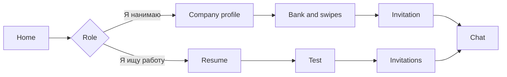

# Product overview

**Requirements:** [BRD](../business/brd/index.md).

## What is KADRY?

**KADRY** is a platform for hiring IT specialists. An employer looks through the bank and the swipes and sends an invitation with a salary band. The candidate decides whether to open contacts.

A category is not a line from the resume. It is a specialization plus a grade after a test. Grades: intern, junior, middle, senior, lead. Until there is a test, the profile is visible without a confirmed category.

The interface is **Russian**. Amounts look like «250 000 ₽».

## Value

| Promise | Meaning |
|---------|---------|
| The employer reaches out | The bank and swipes, an invitation without a required vacancy |
| The grade is checked | A test from the task bank, not a self-assessment in the resume |
| Contacts stay closed | Email and phone are visible to the company after «Принять» |
| The feed explains itself | The card has reasons: the test score and the FSP line |
| The FSP link | Achievements come from the registry and do not set the grade |

## Who uses it

| Role | Why they come |
|------|----------------|
| Candidate | Resume, test, invitations, vacancy feed, FSP link |
| Employer | Company profile, bank, swipes, vacancies, invitation, chat, ATS |
| Administrator | Task bank, analytics, company checks, ban list, journal |

One account has one role. Someone else's object is unavailable.

## What a person does

A chat opens when the candidate accepts an invitation or when interest is mutual. There is no video call inside the platform: a meeting is a date and a link to an external call.

## Boundaries

The product has sign-up with a code from email, a resume and PDF parsing, a test and a written interview, the bank, swipes, vacancies, invitations, chat, a calendar, company take-homes, and an ATS poll. It does not have a survey before the test, proctoring, a voice interview, sign-in through government services, two-factor authentication, or a classic application with a cover letter.
