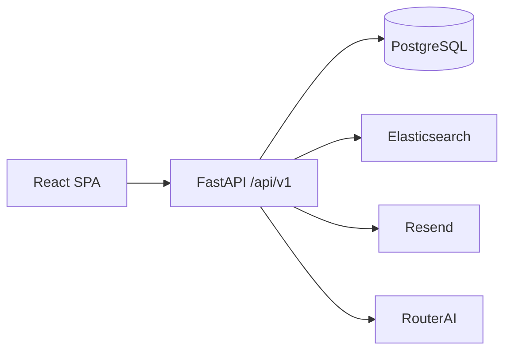

# Architecture

A monolith of two parts in one repository: `frontend/` and `backend/`. One `.env`, one CI. There is no shared JavaScript between them.

Candidate search uses Elasticsearch when `ELASTICSEARCH_URL` is set, otherwise the database. Mail is Resend. Without a key outside production the confirmation code is written to the log. Resume recognition and the AI interview use RouterAI only when `ROUTERAI_API_KEY` is set.

## Frontend

Feature-Sliced layers: `app → pages → widgets → features → entities → shared`. A layer does not import a layer above it. A slice's public API is `index.ts`. Entities refer to each other through `@x`.

Routes are in `frontend/src/shared/config/routes.ts`. Among them: `/`, `/auth`, cabinets `/profile/*`, the feed `/feed`, `/vacancies`, `/responses`, `/calendar`, `/matching`, `/testing`, `/testing/builder`, `/admin`, public `/companies/:id` and `/candidates/:id`, and the FSP return `/profile/fsp/callback`.

Server state is TanStack Query. The session is an external store. Client access is `RequireAuth`. The real check is on the backend.

## Backend

| Layer | What it does |
|-------|----------------|
| `api/routes` | Paths, statuses, dependencies. No domain rules |
| `dependencies` | DB session, current user, `require_roles` |
| `services` | Scenarios |
| `repositories` | Queries |
| `models` | SQLAlchemy 2, not returned outside |
| `schemas` | Pydantic, camelCase on the wire |
| `core` | Settings, Argon2id, JWT, errors |
| `admin` | A separate admin package: bank, analytics, ban list, parameters, verification |
| `integrations/fsp` | The FSP ID provider and the registry client |

An API error is `{"error": {"code", "message", "details"}}`. An unfinished scenario answers `501` with code `not_implemented`, without fake logic.

Passwords are Argon2id. An unknown email and a wrong password return one answer. A dummy hash is verified to keep the timing even. JWT is HS256, with claims close to Keycloak (`sub`, `email`, `realm_access.roles`), so RS256 via JWKS can be accepted later. The minimum password length in the registration schema is 8 characters (`PASSWORD_MIN_LENGTH` in `schemas/auth.py`). That is shorter than NFR-04.
