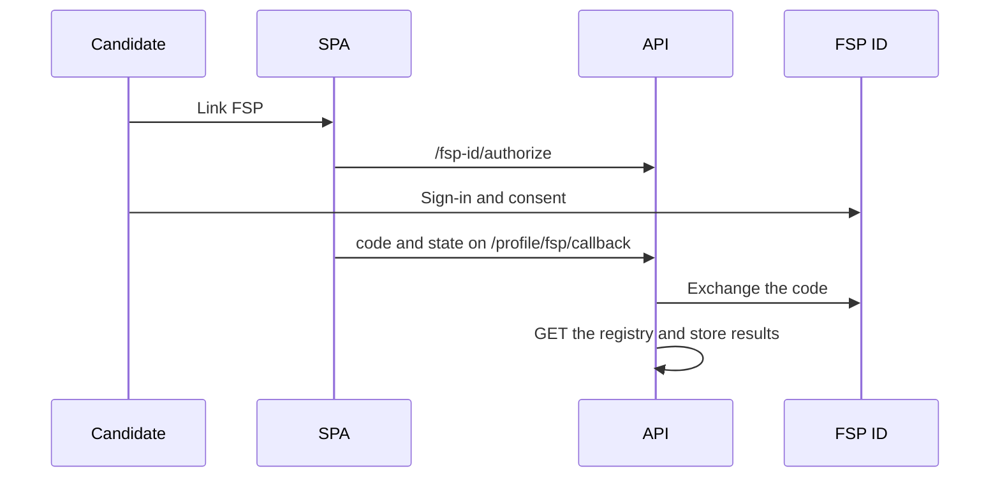

# FSP ID

The full contract is `docs/FSP_INTEGRATION.md` and `fsp-registry.openapi.yaml`. This page is the short loop as it exists in the code.

Sign-in to the platform stays email and password. FSP ID does not issue our tokens and does not create an account. Linking is available to a signed-in candidate who already has a resume.

The organisers do not grant access to the real systems, so both run as an emulation when `FSP_ID_MODE=mock`: Keycloak paths, authorization code plus PKCE, ID-token claims, and a registry record. Moving to real Keycloak is a configuration change, in the package `backend/app/integrations/fsp/`.

An empty registry response is a normal result, not an error. Results affect profile strength inside a category and do not set the grade. Unlink is `DELETE /candidates/me/fsp-link`. Import again is `POST /candidates/me/fsp-sync`.

The «once every 24 hours» schedule from FR-К-09 was not found as a background job in this pass: the routes have a manual sync and an import at the moment of linking.
