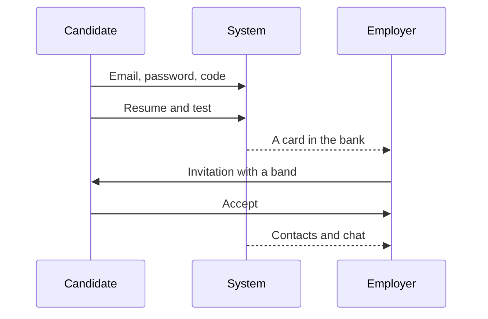

# End-to-end demo

Five steps on synthetic data. The sixth shows ATS and does not mix it into the bank.

1. Sign-up. Home → «Я ищу работу» → email, password, consent → the code → resume → «Сохранить резюме».
2. Test. «Начать тест» → one of five grades → tasks. If the code passed the hidden tests and a model key is set — «Отправить ответы».
3. Category. A counted attempt is visible to the employer as a specialization and a grade.
4. Search. The employer opens the bank or the swipes and sees a card without an email.
5. Contact. «Отправить приглашение» → the candidate presses «Принять» → chat.
6. ATS, extra. «Подключить демо» → «Опросить». Three external applications get a decision. They are not in the candidate feed.
