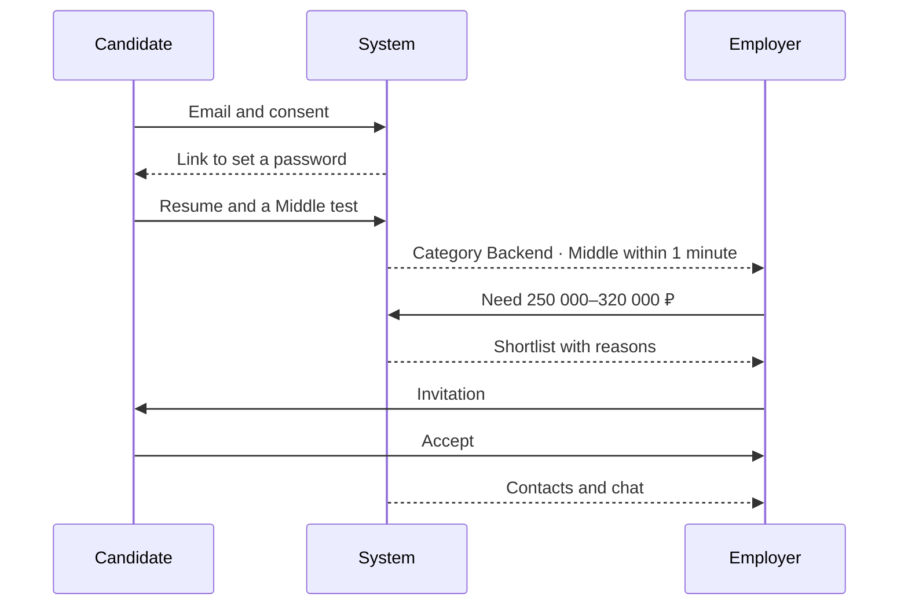

# End-to-end demo

Steps 1–5 run in order and are shown in 15 minutes on synthetic data. Step 6 is extra.

1. Registration. Home → «Я ищу работу» → email and consent → letter → password → onboarding → resume from a PDF → «Сохранить резюме».
2. Survey and test. «Предложение теста» → survey → grade Middle → device check → 4 tasks → an AI interview after each.
3. Category. Score 74 of 100, sub-level Middle → «Принять грейд» → «Backend · Middle» is visible to employers within 1 minute.
4. Search. The employer describes Backend, Middle–Middle+, Python, PostgreSQL, 250 000–320 000 ₽. The shortlist shows the person from step 3 with the reasons «Грейд подтверждён тестом: 74 из 100» and «Стек совпадает: 2 из 2 обязательных».
5. Contact. Swipe right → favourites → invitation. The candidate opens the card (the employer sees «Просмотрено») → «Принять» → contacts and chat.
6. Application, extra. The employer publishes the need. A second candidate swipes the vacancy right. The employer presses «Принять» on «Отклики» → chat.

A separate showing of the test. «Сборка теста под потребность» on three demo needs → the pattern card → two variants side by side → calibration and the one-prompt check → the dashboard.

A separate showing of matching. Reasons → the filter «Есть достижения ФСП» and a reset that does not lose the shortlist → a need change and versions → the K1 block on the dashboard.
