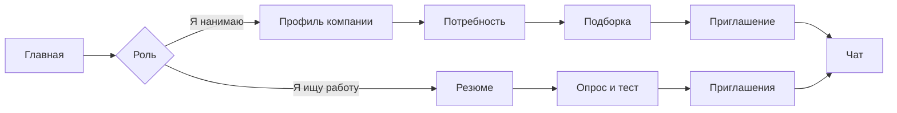

# Обзор продукта

**Нормативные требования:** [BRD](../business/brd/index.md).

## Что такое KADRY?

**KADRY** — платформа подбора ИТ-специалистов для кейса Федерации спортивного программирования. Работодатель не ждёт откликов в общую ленту: он описывает потребность, получает подборку людей с подтверждённым грейдом и сам отправляет приглашение с зарплатной вилкой. Кандидат решает, открывать ли контакты.

Категория — это не строка из резюме. Это специализация плюс грейд, которые система ставит после опроса, выбора уровня и теста. Пока теста нет, профиль виден, но всегда ниже подтверждённых.

Интерфейс на **русском**. Суммы в виде «250 000 ₽», даты ДД.ММ.ГГГГ.

## Ценность

| Обещание | Смысл |
|----------|--------|
| Работодатель выходит сам | Подборка по категории, приглашение без обязательной опубликованной вакансии |
| Грейд проверяется | Тест из вариантов одного паттерна, а не самооценка в резюме |
| Контакты не утекают заранее | Почта и телефон компании видны только после принятия приглашения или отклика |
| Объяснимая выдача | У каждого кандидата в подборке 2–3 причины попадания с числами |
| Связь с ФСП | Достижения участника усиливают позицию внутри категории и не задают грейд |

## Кто пользуется

| Роль | Зачем приходит |
|------|----------------|
| Кандидат | Резюме, тест, приглашения, по желанию — вакансии и связь с ФСП |
| Работодатель | Профиль компании, потребность, подборка, приглашение, чат |
| Администратор | Банк заданий, очередь прокторинга, справочники, жалобы, банлист |

Один аккаунт — одна роль. Чужой объект открывается как страница 403, без подробностей.

## Что человек делает

Кандидат после входа с резюме попадает на «Приглашения». Работодатель начинает с потребностей. Чат открывается, когда кандидат принял приглашение, работодатель принял отклик или случился взаимный матч. Видеосвязи внутри платформы нет: встреча — это дата и ссылка на внешний созвон.

## Границы

MVP закрывает регистрацию, резюме, тест и категорию, подбор, приглашение и раскрытие контактов. Публикация вакансий, календарь, тестовые работодателя, регулярные задачи и защита от фиктивных вакансий помечены как **Доп**. Вход через Госуслуги, GDPR и встроенная видеосвязь в хакатон не входят. Подробности — в [спецификации](../business/specification.md) и [покрытии](../business/coverage.md).
