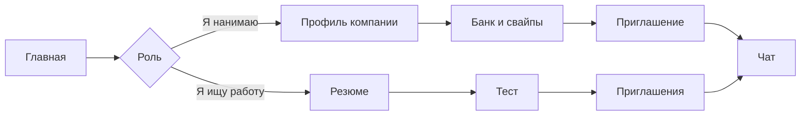

# Обзор продукта

**Нормативные требования:** [BRD](../business/brd/index.md).

## Что такое KADRY?

**KADRY** — платформа подбора ИТ-специалистов. Работодатель смотрит банк и свайпы, сам отправляет приглашение с зарплатной вилкой. Кандидат решает, открывать ли контакты.

Категория — это не строка из резюме. Это специализация плюс грейд после теста. Грейды: стажёр, junior, middle, senior, lead. Пока теста нет, профиль виден без подтверждённой категории.

Интерфейс на **русском**. Суммы в виде «250 000 ₽».

## Ценность

| Обещание | Смысл |
|----------|--------|
| Работодатель выходит сам | Банк и свайпы, приглашение без обязательной вакансии |
| Грейд проверяется | Тест из банка заданий, а не самооценка в резюме |
| Контакты не открыты заранее | Почта и телефон компании видны после «Принять» |
| Выдача объясняет себя | На карточке есть причины: балл теста и строка ФСП |
| Связь с ФСП | Достижения подтягиваются из реестра и не ставят грейд |

## Кто пользуется

| Роль | Зачем приходит |
|------|----------------|
| Кандидат | Резюме, тест, приглашения, лента вакансий, связь с ФСП |
| Работодатель | Профиль компании, банк, свайпы, вакансии, приглашение, чат, ATS |
| Администратор | Банк заданий, аналитика, проверка компаний, банлист, журнал |

Один аккаунт — одна роль. Чужой объект недоступен.

## Что человек делает

Чат открывается, когда кандидат принял приглашение или когда интерес взаимный. Видеосвязи внутри платформы нет: встреча — это дата и ссылка на внешний созвон.

## Границы

В продукте есть регистрация с кодом из письма, резюме и разбор PDF, тест и текстовое интервью, банк, свайпы, вакансии, приглашения, чат, календарь, тестовые компании и опрос ATS. Нет опроса перед тестом, прокторинга, голосового интервью, входа через Госуслуги, двухфакторной аутентификации и классического отклика с сопроводительным письмом.
