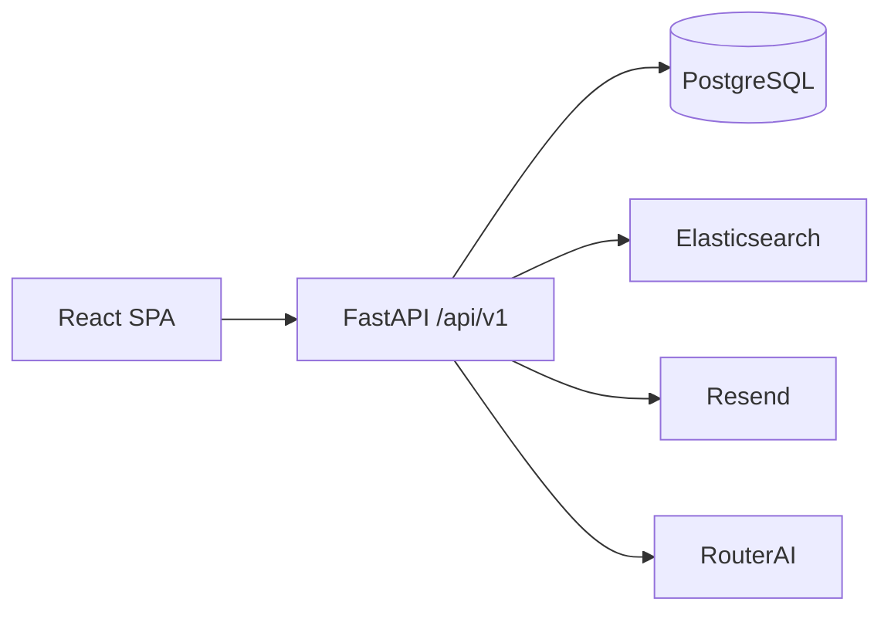

# Архитектура

Монолит из двух частей в одном репозитории: `frontend/` и `backend/`. Общий `.env`, общий CI. Общего JS-кода между ними нет.

Поиск кандидатов идёт в Elasticsearch, если задан `ELASTICSEARCH_URL`, иначе по базе. Письма — Resend, без ключа в не-production код подтверждения пишется в лог. Распознавание резюме и ИИ-собеседование — RouterAI, только если задан `ROUTERAI_API_KEY`.

## Frontend

Слои Feature-Sliced: `app → pages → widgets → features → entities → shared`. Слой не импортирует верхний. Публичный API слайса — `index.ts`. Сущности ссылаются друг на друга через `@x`.

Маршруты заданы в `frontend/src/shared/config/routes.ts`. Среди них: `/`, `/auth`, кабинеты `/profile/*`, лента `/feed`, `/vacancies`, `/responses`, `/calendar`, `/matching`, `/testing`, `/testing/builder`, `/admin`, публичные `/companies/:id` и `/candidates/:id`, возврат FSP `/profile/fsp/callback`.

Серверное состояние — TanStack Query. Сессия — внешний store. Доступ на клиенте — `RequireAuth`, настоящая проверка на бэкенде.

## Backend

| Слой | Что делает |
|------|------------|
| `api/routes` | Пути, статусы, зависимости. Без правил предметной области |
| `dependencies` | Сессия БД, текущий пользователь, `require_roles` |
| `services` | Сценарии |
| `repositories` | Запросы |
| `models` | SQLAlchemy 2, наружу не отдаются |
| `schemas` | Pydantic, camelCase на проводе |
| `core` | Настройки, Argon2id, JWT, ошибки |
| `admin` | Отдельный пакет админки: банк, аналитика, банлист, параметры, верификация |
| `integrations/fsp` | Провайдер FSP ID и клиент реестра |

Ошибка API: `{"error": {"code", "message", "details"}}`. Несделанный сценарий отвечает `501` с кодом `not_implemented`, без фиктивной логики.

Пароли — Argon2id. Неизвестный email и неверный пароль дают один ответ, для выравнивания времени считается пустой хэш. JWT HS256, claims в форме, близкой к Keycloak (`sub`, `email`, `realm_access.roles`), чтобы позже принять RS256 через JWKS. Минимальная длина пароля в схеме регистрации — 8 символов (`PASSWORD_MIN_LENGTH` в `schemas/auth.py`). Это короче NFR-04.
