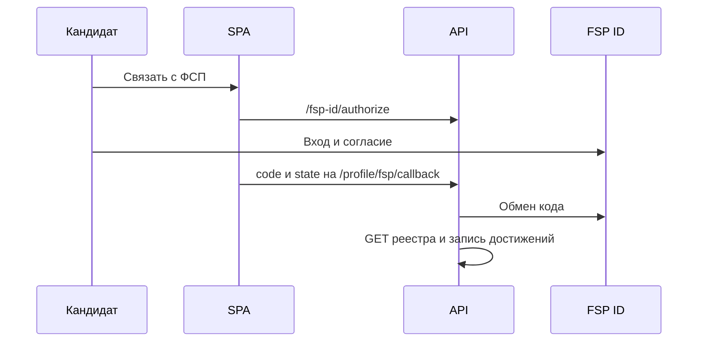

# FSP ID

Полный контракт — `docs/FSP_INTEGRATION.md` и `fsp-registry.openapi.yaml`. Здесь короткий контур, как он есть в коде.

Вход на платформу остаётся почтой и паролем. FSP ID не выдаёт наши токены и не создаёт аккаунт. Привязка доступна вошедшему кандидату, у которого уже есть резюме.

Организаторы не дают доступ к настоящим системам, поэтому обе работают в эмуляции при `FSP_ID_MODE=mock`: пути Keycloak, обмен authorization code и PKCE, claims ID-токена и запись реестра. Переход на настоящий Keycloak — смена конфигурации, пакет `backend/app/integrations/fsp/`.

Пустой ответ реестра — обычный результат, не ошибка. Достижения влияют на силу профиля внутри категории и не задают грейд. Отвязка — `DELETE /candidates/me/fsp-link`. Повторный импорт — `POST /candidates/me/fsp-sync`.

Расписание «раз в 24 часа» из FR-К-36 в коде как фоновая задача не искалось отдельно: в маршрутах есть ручная синхронизация и импорт в момент привязки.
