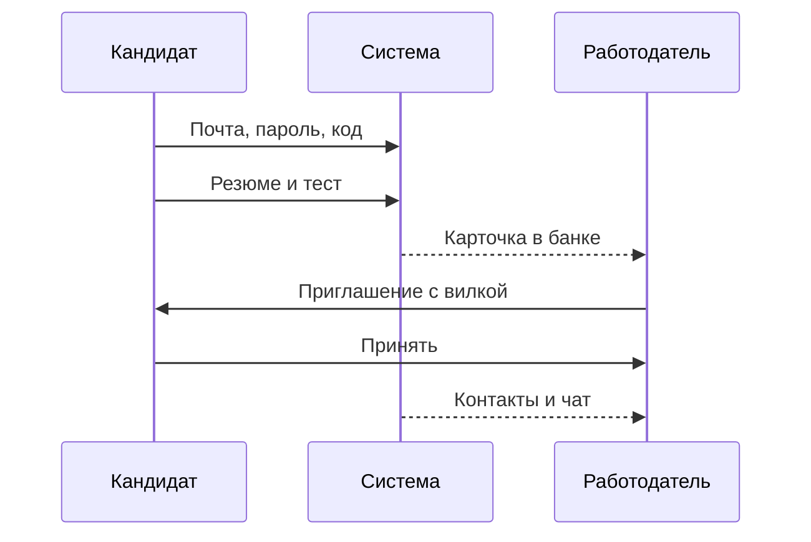

# Сквозной сценарий демо

Пять шагов на синтетических данных. Шестой показывает ATS и не смешивает её с банком.

1. Регистрация. «Главная» → «Я ищу работу» → почта, пароль, согласие → код → резюме → «Сохранить резюме».
2. Тест. «Начать тест» → один из пяти грейдов → задания. Если код прошёл скрытые тесты и ключ модели задан — «Отправить ответы».
3. Категория. Засчитанная попытка видна работодателю как специализация и грейд.
4. Поиск. Работодатель открывает банк или свайпы и видит карточку без почты.
5. Контакт. «Отправить приглашение» → кандидат нажимает «Принять» → чат.
6. ATS, дополнительно. «Подключить демо» → «Опросить». Три внешних отклика получают решение. В ленте кандидатов их нет.
