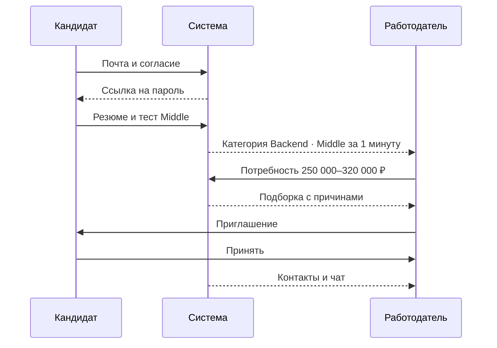

# Сквозной сценарий демо

Шаги 1–5 идут подряд и показываются за 15 минут на синтетических данных. Шаг 6 — дополнительный.

1. Регистрация. «Главная» → «Я ищу работу» → почта и согласие → письмо → пароль → онбординг → резюме из PDF → «Сохранить резюме».
2. Опрос и тест. «Предложение теста» → опрос → грейд Middle → проверка оборудования → 4 задачи → ИИ-интервью после каждой.
3. Категория. Балл 74 из 100, подуровень Middle → «Принять грейд» → «Backend · Middle» видна работодателям за 1 минуту.
4. Поиск. Работодатель описывает Backend, Middle–Middle+, Python, PostgreSQL, 250 000–320 000 ₽. В подборке кандидат из шага 3 с причинами «Грейд подтверждён тестом: 74 из 100» и «Стек совпадает: 2 из 2 обязательных».
5. Контакт. Свайп вправо → избранное → приглашение. Кандидат открывает карточку (у работодателя «Просмотрено») → «Принять» → контакты и чат.
6. Отклик, Доп. Работодатель публикует потребность. Второй кандидат свайпает вакансию вправо. Работодатель на «Откликах» нажимает «Принять» → чат.

Отдельный показ теста. «Сборка теста под потребность» на трёх демо-потребностях → карточка паттерна → два варианта рядом → калибровка и проверка «одного промпта» → дашборд.

Отдельный показ подбора. Причины → фильтр «Есть достижения ФСП» и сброс без потери подборки → смена потребности и версии → блок К1 на дашборде.
