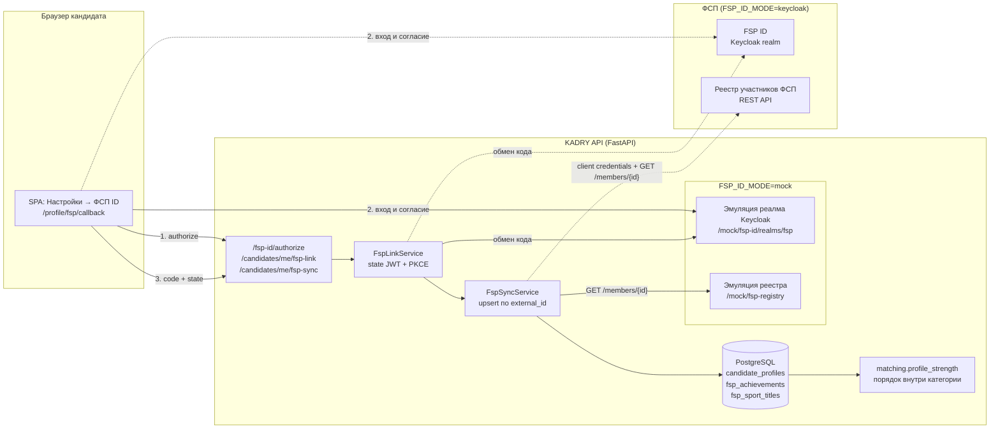
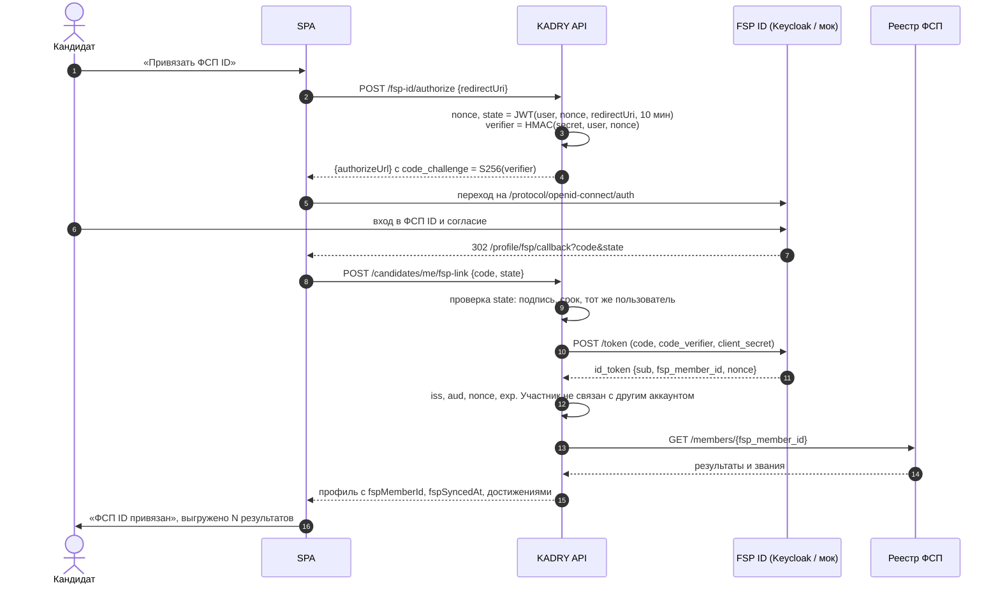
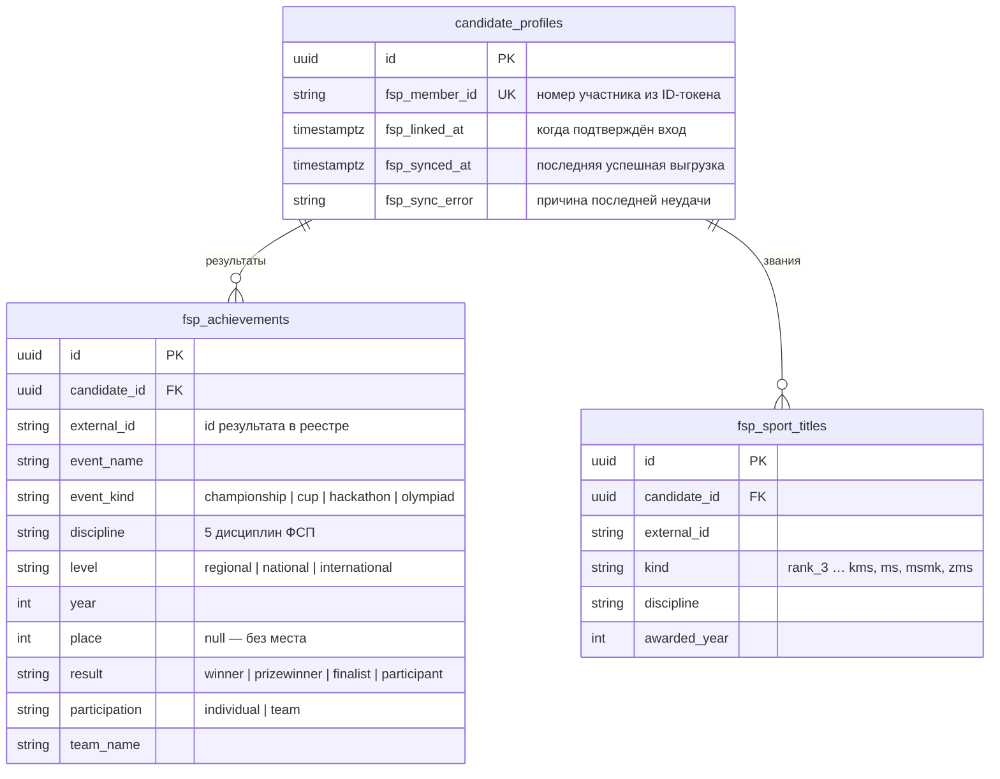

# Интеграция с FSP ID и реестром ФСП

Кандидат связывает профиль платформы со своим участником Федерации спортивного программирования,
а платформа выгружает из реестра ФСП его подтверждённые результаты и спортивные звания.

Организаторы доступа к настоящим системам не дают, поэтому сейчас обе работают **в режиме
эмуляции внутри API** (`FSP_ID_MODE=mock`), но с реальными контрактами: пути Keycloak, обмен
authorization code + PKCE, claims ID-токена и формат записи реестра из
[`fsp-registry.openapi.yaml`](fsp-registry.openapi.yaml). Переход на настоящие FSP ID и реестр —
это смена конфигурации (раздел «Переход на настоящий FSP ID»), без изменений в коде и данных.

## Правила, заданные организаторами

| Правило | Как выполнено |
| ------- | ------------- |
| Вход на платформу — по email, FSP ID только привязывается | FSP ID не выдаёт наших токенов и не создаёт аккаунтов. Привязка доступна только вошедшему кандидату с сохранённым резюме |
| Кандидат без истории в ФСП работает как обычно | Пустой ответ реестра — нормальный результат, а не ошибка. Категорию и грейд задают тест и опыт, без ФСП ничего не блокируется |
| Достижения ФСП — фактор ранжирования внутри категории, грейд они не задают | Результаты дают до 0,4 в «силе профиля», которая упорядочивает кандидатов одной категории. В расчёт категории и грейда ФСП не входит, это закреплено тестом |
| Только мок, без настоящего Keycloak в docker | Эмуляция — роутер `app/api/routes/mock_fsp.py`, подключается только при `FSP_ID_MODE=mock` |
| Документация: схема архитектуры и спецификация API | Этот файл и `fsp-registry.openapi.yaml`; эндпоинты платформы описаны в OpenAPI самого API (`/api/docs`) |

## Архитектура



Код интеграции — пакет `backend/app/integrations/fsp/`:

| Модуль | Назначение |
| ------ | ---------- |
| `provider.py` | Интерфейс `FspIdProvider`, общие проверки claims ID-токена, построение URL авторизации, белый список адресов возврата |
| `mock.py` | `MockFspIdProvider` и `MockFspRegistry`: коды и токены — JWT, история — из демо-данных или детерминированно сгенерированная |
| `keycloak.py` | `KeycloakFspIdProvider`: confidential client, обмен кода у token endpoint реалма |
| `registry.py` | Интерфейс `FspRegistryClient` и `HttpFspRegistryClient` (сервисный токен client credentials) |
| `sync.py` | `FspSyncService`: применение записи реестра к профилю, политика ошибок |
| `schemas.py` | Запись реестра (`FspMemberRecord`) — то же, что в `fsp-registry.openapi.yaml` |

Фабрики `fsp_id_provider()` и `fsp_registry()` выбирают реализацию по `FSP_ID_MODE`; сервисы
зависят только от интерфейсов.

## Привязка: OIDC authorization code + PKCE



Решения:

- **Без хранения состояния.** `state` — короткоживущий JWT, подписанный секретом API и привязанный
  к пользователю. PKCE-verifier не хранится и не покидает сервер: он вычисляется как HMAC от
  пользователя и nonce при старте и повторно при обмене кода. Поэтому код, перехваченный у
  другого пользователя, не обменять: verifier не совпадёт, PKCE-проверка провалится.
- **Адрес возврата** — только `FSP_ID_REDIRECT_URI` или тот же путь `/profile/fsp/callback` на
  одном из доверенных origin из `CORS_ORIGINS`. Эмулятор (`FSP_ID_MODE=mock`) дополнительно
  принимает этот путь на локальных адресах — `localhost`, `127.0.0.1`, IP локальной сети — с любым
  портом, чтобы демо работало и через Vite (`:5173`), и через Docker (`:8080`). Публичный домен
  по-прежнему нужно указать в `FSP_ID_REDIRECT_URI` или `CORS_ORIGINS`.
- **Один участник — один аккаунт.** Попытка привязать уже связанного участника — `409`.
  Повторный вход тем же участником просто обновляет данные; вход другим участником заменяет
  прежнюю историю.
- **Отвязка** удаляет номер участника, результаты и звания; ранжирование возвращается к тесту.

### Эндпоинты платформы

| Метод и путь | Кто | Что делает |
| ------------ | --- | ---------- |
| `POST /api/v1/fsp-id/authorize` `{redirectUri}` | кандидат | Возвращает `{authorizeUrl}` реалма FSP ID |
| `POST /api/v1/candidates/me/fsp-link` `{code, state}` | кандидат | Завершает вход, связывает участника, выгружает историю |
| `POST /api/v1/candidates/me/fsp-sync` | кандидат | Повторно читает реестр без нового входа |
| `DELETE /api/v1/candidates/me/fsp-link` | кандидат | Отвязывает профиль |

Ошибки — в общем формате API: `400 fsp_id_failed` (отменённый, просроченный или чужой вход,
провал PKCE, неверный ID-токен), `404` (резюме ещё не сохранено), `409` (участник связан с
другим аккаунтом).

### Эмуляция реалма (`FSP_ID_MODE=mock`)

| Путь (относительно `/api/v1/mock/fsp-id/realms/fsp`) | Как в Keycloak |
| ---------------------------------------------------- | -------------- |
| `/.well-known/openid-configuration` | Discovery-документ |
| `/protocol/openid-connect/auth` | Страница входа: логин и пароль демо-аккаунта или любой ID участника |
| `/protocol/openid-connect/token` | Обмен кода: проверяет client_id, redirect_uri и PKCE S256, выдаёт `id_token` и `access_token` |
| `/protocol/openid-connect/userinfo` | Claims по access-токену |

Эмулятор реестра: `GET /api/v1/mock/fsp-registry/members/{memberId}`.

Демо-аккаунты на странице входа. Пароль у всех `kadry-demo-2026`. Неверный пароль отвечает «Неверный логин или пароль» и форму не закрывает.

| Логин | ID | Что проверяет |
| ----- | -- | ------------- |
| `champion` | `FSP-100101` | Обычная история: результаты разного уровня, командные и личные, звания |
| `cup` | `FSP-100202` | То же, другой набор |
| `hackathon` | `FSP-100303` | То же, другой набор |
| `empty` | `FSP-000000` | Участник без истории в ФСП: привязка проходит, результатов нет |
| `offline` | `FSP-000503` | Реестр недоступен: связь сохраняется, кандидат видит ошибку и кнопку «Обновить» |
| поле «Или ID участника» | любой другой | История генерируется детерминированно по ID и одинакова при каждом запросе |

Номера участников демо-профилей (`fsp_member_id` в `app/seed/data/candidates.json`) отдают ту же
историю, что лежит в базе, поэтому повторная выгрузка у демо-аккаунта ничего не меняет.

Токены эмулятора подписаны HS256 ключом, производным от `JWT_SECRET`, и имеют свой `typ` и
`iss`: они не принимаются вместо токенов платформы и наоборот.

## Модель данных



Пары `(candidate_id, external_id)` уникальны в обеих таблицах. Миграция
`20261013_e7a1c3b5d9f2_fsp_registry_sync` добавляет поля и заполняет их у существующих записей:
`result` выводится из места, `event_kind` — из названия, участие считается личным.

## Синхронизация и ошибки

- Выгрузка — при привязке и по кнопке «Обновить из реестра» (`POST /candidates/me/fsp-sync`).
  Реестр читается сервисным токеном платформы (client credentials того же клиента Keycloak),
  поэтому кандидату не нужно входить в ФСП ID повторно.
- Запись реестра применяется как **upsert по `external_id`**: новые результаты добавляются,
  изменённые обновляются, исчезнувшие из реестра удаляются. Повторная выгрузка идемпотентна.
- Участник, неизвестный реестру (`404`), — пустая история, а не ошибка.
- **Реестр недоступен** (сеть, 5xx, неизвестный формат, запись другого участника): связь
  сохраняется, прежние данные не трогаются, `fspSyncError` объясняет кандидату, что случилось.
  Успешная выгрузка очищает ошибку и ставит `fspSyncedAt`.
- Достижения нельзя ввести или изменить вручную: в API нет такого эндпоинта, в интерфейсе нет
  такой формы. Номер участника тоже не вводится: его подтверждает ФСП ID.

## Ранжирование: порядок внутри категории, не грейд

Категория (специализация + грейд) определяется тестом и анкетой. ФСП в неё не входит. Сила
профиля (0–1), по которой упорядочены кандидаты одной категории:

\[ \text{сила} = 0{,}6 \cdot \frac{\text{балл теста}}{100} + \min(0{,}4,\ \text{ФСП}) \]

ФСП-часть (`app/services/matching.py`):

| Лучший результат | Международный | Всероссийский | Региональный |
| ---------------- | ------------- | ------------- | ------------ |
| Победитель | 0,40 | 0,38 | 0,30 |
| Призёр, 2-е место (призёр без места — так же) | 0,37 | 0,35 | 0,26 |
| Призёр, 3-е место | 0,34 | 0,32 | 0,23 |
| Финалист | 0,27 | 0,25 | 0,15 |
| Участник | 0,17 | 0,15 | 0,08 |

- командный результат — × 0,9: успех разделён с командой;
- каждый следующий результат — + 0,02;
- высшее звание — от + 0,01 (3-й разряд) до + 0,05 (МСМК, ЗМС);
- сумма ограничена 0,4, поэтому даже чемпион мира не обгонит кандидата с заметно лучшим тестом.

Кандидат без истории в ФСП получает 0 в ФСП-части и ранжируется по тесту — как любой другой.
Причины позиции на карточке рекрутера называют результат: «ФСП: призёр, 2-е место — Кубок России
(алгоритмическое программирование, 2025), команда «NullPointer»; КМС». Поиск по банку находит
кандидатов по словам «хакатон», «призёр», «КМС» и названиям команд.

Тесты: `backend/tests/test_matching.py` (сила профиля, вес команды и званий, независимость
грейда и категории от ФСП), `backend/tests/test_fsp_integration.py` (весь поток привязки через
эмулятор, 409, ошибка реестра, участник без истории, повторная выгрузка, чужой state и код).

## Переход на настоящий FSP ID

1. Зарегистрировать в реалме ФСП confidential client (`FSP_ID_CLIENT_ID`) со standard flow,
   PKCE S256 и redirect URI `https://<домен>/profile/fsp/callback`; включить service account для
   чтения реестра.
2. Добавить в реалме mapper claim `fsp_member_id` (номер участника) в ID-токен; scope
   `fsp-profile`.
3. Задать переменные:

   ```env
   FSP_ID_MODE=keycloak
   FSP_ID_ISSUER=https://id.fsp-russia.ru/realms/fsp
   FSP_ID_CLIENT_ID=kadry
   FSP_ID_CLIENT_SECRET=<секрет клиента>
   FSP_ID_REDIRECT_URI=https://<домен>/profile/fsp/callback
   FSP_REGISTRY_URL=https://registry.fsp-russia.ru/api/v1
   ```

   В этом режиме эмулятор не подключается, его пути отвечают `404`.
4. Согласовать с ФСП API реестра по `fsp-registry.openapi.yaml` или написать адаптер,
   реализующий `FspRegistryClient`.
5. Для продакшена — проверять подпись ID-токена по JWKS реалма (RS256): добавить
   `pyjwt[crypto]` и `jwt.PyJWKClient` в `keycloak.py`. Сейчас токен получен напрямую от token
   endpoint по TLS, что допускает OIDC Core 3.1.3.7, а claims (`iss`, `aud`, `nonce`, `exp`)
   проверяются всегда.
6. Разрешить домен FSP ID в CSP фронтенда, если она ограничивает переходы.

## Что дальше

- **Вход через FSP ID** как второй способ входа: те же провайдер и claims, плюс связь
  `sub` ↔ пользователь. Сейчас организаторы требуют вход по email.
- **Вебхуки реестра** о новых результатах вместо ручного «Обновить» или фоновая выгрузка по
  расписанию для профилей, где `fspSyncedAt` старше суток.
- Отзыв согласия на стороне ФСП (back-channel logout) — автоматическая отвязка.
