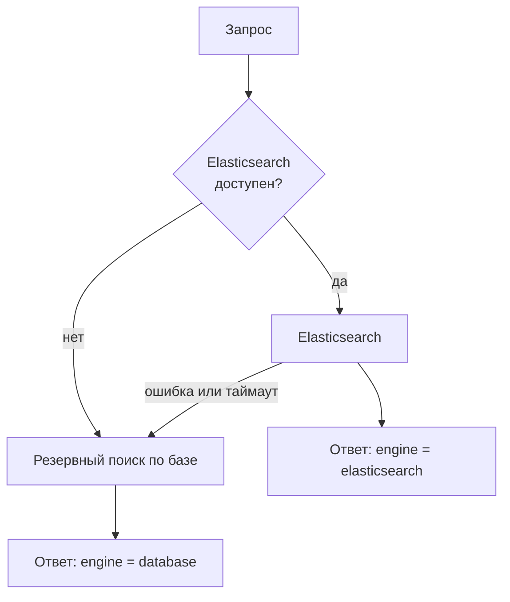

# Как работает поиск в КАДРЫ

Поиск в платформе идёт в две стороны:

| Кто ищет | Что находит | Где в интерфейсе | API |
| -------- | ----------- | ---------------- | --- |
| Работодатель | кандидатов | «Лента» → «Кандидаты» | `GET /candidates` |
| Соискатель | вакансии | «Лента» → «Вакансии для вас» | `GET /vacancies/feed` |

У обеих сторон одна и та же идея: **сначала фильтры отсекают лишнее, потом объяснимая оценка
расставляет оставшихся по порядку, и каждая карточка говорит, почему она на своём месте.** Ничего
не решает «чёрный ящик»: любую позицию в списке можно пересчитать руками по правилам ниже.

Документ описывает поведение, а не историю. Если вы меняете поиск, дочитайте до раздела
[«Как менять поиск»](#как-менять-поиск): там список мест, которые нужно править вместе.

- [Что видит каждая сторона](#что-видит-каждая-сторона)
- [Откуда берутся категория и сила профиля](#откуда-берутся-категория-и-сила-профиля)
- [Поиск кандидатов для работодателя](#поиск-кандидатов-для-работодателя)
- [Поиск вакансий для соискателя](#поиск-вакансий-для-соискателя)
- [Оценка соответствия: 100 баллов](#оценка-соответствия-100-баллов)
- [Фильтры: счётчики, пустая выдача, готовые наборы](#фильтры-счётчики-пустая-выдача-готовые-наборы)
- [Сохранённые поиски и уведомления](#сохранённые-поиски-и-уведомления)
- [Два движка: Elasticsearch и база](#два-движка-elasticsearch-и-база)
- [Как менять поиск](#как-менять-поиск)
- [Ограничения и особенности](#ограничения-и-особенности)
- [Где что лежит в коде](#где-что-лежит-в-коде)

---

## Что видит каждая сторона

**Работодатель** ищет по банку кандидатов. В выдачу попадает профиль, только если одновременно:

1. соискатель не скрыл себя: статус в кабинете — «Активно ищу работу» или «Открыт к предложениям»
   (статус «Не ищу работу» убирает профиль из поиска полностью);
2. у профиля есть **категория**: заданы и специализация, и грейд.

Контакты (почта, телефон, Telegram) в поиске **не приходят никогда**. Они открываются на странице
кандидата и только после принятого приглашения. Дата рождения не видна вообще: работодатель
получает лишь пометку «до 18».

**Соискатель** ищет по опубликованным вакансиям. Черновики видит только своя компания.
Опубликованную вакансию любой соискатель найдёт в режиме «Свободный поиск», даже если она не
подходит его профилю.

У каждой стороны есть личные списки решений. Они меняют то, что показывает поиск:

| Список (`view`) | Что в нём | Где применяется |
| --------------- | --------- | --------------- |
| `all` (по умолчанию) | всё, кроме того, что вы пропустили («Не интересно») | обычная лента |
| `unseen` | всё, по чему вы ещё не приняли решение | колода свайпов: после лайка или пропуска карточка исчезает |
| `liked` | то, что вы отобрали («Отобрать») | вкладка «Отобрано» |
| `matched` | взаимный интерес: вы отобрали, и вас отобрали в ответ | вкладка «Взаимно» |
| `skipped` | то, что вы пропустили, — любую карточку можно вернуть | вкладка «Вырезано» |

«Взаимно» у работодателя — это когда он отобрал кандидата, а кандидат отобрал любую вакансию его
компании. У соискателя — когда он отобрал вакансию, а рекрутёр этой компании отобрал его.
Списки `liked`, `matched` и `skipped` показывают решения **независимо от профиля**: даже если вы
сменили специализацию, ранее отобранные вакансии остаются в списке.

---

## Откуда берутся категория и сила профиля

Оба понятия нужны поиску, поэтому коротко.

**Категория** — пара «специализация + грейд», например «Backend-разработка · Middle». Специализацию
соискатель выбирает в резюме, а **грейд подтверждает тест**. Сдал тест на Middle — в профиле
Middle и метка «Грейд подтверждён тестом: 78 из 100». Тест не сдан или пропущен — грейд указан
самим человеком, и карточка честно пишет «Грейд указан без теста». Результаты ФСП категорию и
грейд **не меняют** — это закреплено тестом.

**Сила профиля** — число от 0 до 1. Оно упорядочивает людей внутри одной категории: подтверждённые
профили идут выше неподтверждённых.

```
сила профиля = 0,6 × (балл теста / 100) + очки ФСП       (очки ФСП не больше 0,4)
```

Очки ФСП берутся из реестра ФСП (привязка через FSP ID):

- считается **лучший** результат по таблице; за каждый следующий добавляется 0,02;
- командный результат весит 0,9 от личного;
- высший разряд или звание добавляет от 0,01 (3-й разряд) до 0,05 (МСМК, ЗМС);
- итог ограничен 0,4.

| Уровень турнира | Победитель | 2-е место | 3-е место | Финалист | Участник |
| --------------- | ---------- | --------- | --------- | -------- | -------- |
| международный | 0,40 | 0,37 | 0,34 | 0,27 | 0,17 |
| всероссийский | 0,38 | 0,35 | 0,32 | 0,25 | 0,15 |
| региональный | 0,30 | 0,26 | 0,23 | 0,15 | 0,08 |

Пример. Тест на 90 баллов даёт 0,54. Серебро всероссийского турнира добавляет 0,35: сила профиля
**0,89**. Тот же тест без ФСП остаётся 0,54, а ФСП без теста даёт не больше 0,4. Подробности
привязки и таблицы — в [`docs/FSP_INTEGRATION.md`](docs/FSP_INTEGRATION.md).

---

## Поиск кандидатов для работодателя

### Что приходит на вход

| Что | Параметр | Комментарий |
| --- | -------- | ----------- |
| Текст | `q` | «сеньор питон kafka», «CTF», опечатки допустимы |
| Фильтры | см. [таблицу](#фильтры-рекрутёра) | все необязательные |
| Вакансия | `vacancyId` | только своя; включает ранжирование по соответствию |
| Список | `view` | см. таблицу выше |
| Сортировка | `sort` | `relevance` (по умолчанию), `assessment`, `salary`, `experience` |
| Страница | `page`, `perPage` | `perPage` до 100 |

### Как строится выдача


1. **База.** Видимые профили с категорией (правила выше).
2. **Список.** `all` убирает пропущенных, `unseen` — всех, по кому уже есть решение, `liked`,
   `matched`, `skipped` оставляют только свои.
3. **Текст.** Если он есть, остаются профили, в которых нашлись все слова запроса.
4. **Фильтры.** Отсекают всё, что не подходит.
5. **Порядок.** Зависит от того, есть ли вакансия, текст и «Будет плюсом» (ниже).
6. **Страница.** Для каждой карточки считаются соответствие вакансии и причины.

### Фильтры рекрутёра

Внутри одной группы варианты складываются через «или» (выбрали два грейда — подойдёт любой из
них), группы между собой — через «и». Исключение — «Обязательный стек»: нужны **все** технологии.

| Группа | Параметры | Как работает |
| ------ | --------- | ------------ |
| Специализация | `specialization[]` | любая из выбранных |
| Грейд | `grade[]` | любой из выбранных |
| Подтверждение | `verifiedOnly` | только с пройденным тестом (есть балл) |
| ФСП | `hasFspAchievements`, `fspResult`, `fspDiscipline` | `true` — есть любой результат; `false` — результатов нет совсем; `fspResult=finalist` — «финалист и выше», `prizewinner` — «призёр» (победитель — тоже призёр); дисциплина сужает: «финалист+ в алгоритмическом» |
| Стаж | `experienceMin` | коммерческий стаж не меньше N лет; если стаж не указан, профиль не проходит |
| Обязательный стек | `stack[]` | **каждая** технология есть у кандидата. Регистр и «ё/е» не важны: `postgresql` = `PostgreSQL` |
| Будет плюсом | `nice[]` | **ничего не отсекает**, только поднимает выше (см. «Порядок») |
| Зарплата | `salaryMin`, `salaryMax` | ожидания кандидата внутри вилки. Кто ожиданий не указал, не отсекается |
| Формат и город | `workFormat[]`, `city[]`, `relocation` | см. ниже |
| Занятость | `employment[]` | полная, частичная, проектная, стажировка: подходит любая из выбранных |
| Готовность | `jobStatus[]` | «Активно ищет» / «Рассматривает предложения» |
| Активность | `activeDays` | заходил на платформу за последние N дней (например, 30) |

**Формат и город** работают вместе, потому что удалёнка не зависит от города:

- выбрана **удалёнка** — кандидату город не нужен, достаточно, чтобы он работал удалённо;
- выбран **офис или гибрид** — кандидат должен быть из одного из указанных городов или (если
  включено «+ готовые к переезду», а оно включено по умолчанию) быть готов переехать;
- формат не выбран, город указан — проверяется только город (и переезд).

Пример: `workFormat=remote&workFormat=hybrid&city=Москва` найдёт всех, кто согласен на удалёнку
(из любого города), и тех, кто согласен на гибрид и живёт в Москве или готов в неё переехать.

### Порядок в выдаче

| Условие | Порядок |
| ------- | ------- |
| есть «Будет плюсом» | сначала те, у кого больше технологий из этого списка, потом как ниже |
| выбрана вакансия | по соответствию вакансии (100 баллов), при равенстве — по силе профиля |
| нет вакансии, есть текст | по релевантности текста, умноженной на силу профиля (подробнее в [особенностях](#ограничения-и-особенности)) |
| нет вакансии, нет текста | по силе профиля: внутри категории первыми идут подтверждённые профили |
| `sort=assessment` | по баллу теста |
| `sort=salary` | по ожиданиям, дешёвые выше; без ожиданий в конце |
| `sort=experience` | по стажу, больше выше; без стажа в конце |

При полном равенстве решает сила профиля, затем идентификатор: порядок всегда один и тот же при
каждом запросе, страницы не «прыгают».

### Что показывает карточка

- **Соответствие вакансии** — только когда выбрана вакансия (0–100 %).
- **Сила профиля** — всегда.
- **Причины** (до пяти строк): «Грейд подтверждён тестом: 91 из 100», лучший результат ФСП
  («Призёр, 2-е место · Кубок России · алгоритмическое программирование, 2025»), совпавший стек,
  формат, город или готовность к переезду, ожидания «в пределах вилки». Без вакансии, но с
  фильтрами по стеку, показывается «Стек: Python, Kafka».

---

## Поиск вакансий для соискателя

### Два режима

| Режим | Что показывает | Порядок |
| ----- | -------------- | ------- |
| **Подбор по профилю** (`mode=profile`, по умолчанию) | вакансии вашей специализации (всех ваших резюме) и смежных, с вашим грейдом или соседним | по соответствию профилю, свежие выше |
| **Свободный поиск** (`mode=free`) | все опубликованные вакансии | новые первыми |

Пока у соискателя нет категории (он не заполнил резюме или не выбрал специализацию и грейд),
лента не персональная: показываются новые вакансии, а над списком — подсказка пройти тест.

**Что значит «ваша специализация».** Основное резюме считается приоритетным, остальные резюме
(вторая профессия) тоже входят в охват, но ранжируются ниже. Смежность задана парами:
backend ↔ fullstack, backend ↔ data engineering, frontend ↔ fullstack, data science ↔ data
engineering, DevOps ↔ информационная безопасность.

**Что значит «ваш грейд».** Вакансия может искать один грейд или два соседних (например,
Middle–Senior). Вакансия попадает в подбор, если любой из её грейдов совпадает с вашим или
отличается на одну ступень. Вакансия на ступень выше получает пометку «шанс вырасти».

При первом заходе «Подбор по профилю» сразу заполняет фильтры из вашего профиля (ожидания,
форматы, занятость, город, стек): значения подписаны «из профиля», а любое изменение — «изменено ·
вернуть».

### Фильтры соискателя

| Группа | Параметры | Как работает |
| ------ | --------- | ------------ |
| Зарплата | `salaryMin` | верхняя граница вилки вакансии не ниже вашего минимума |
| Формат | `workFormat[]` | любой из выбранных |
| Город | `city[]`, `relocation` | удалённой вакансии город не нужен; офис и гибрид — в одном из ваших городов, а с `relocation=true` ещё и вакансии других городов, где компания помогает с переездом |
| Занятость | `employment[]` | любая из выбранных |
| Обязательный стек | `stack[]` | вакансия требует **все** эти технологии (в её стеке, обязательном или желательном) |
| Будет плюсом | `nice[]` | не отсекает, поднимает вакансии с этими технологиями |
| Условия | `benefit[]`, `accredited` | ДМС, гибкое начало дня, оформление по ТК РФ — **все** выбранные; «Аккредитованная IT-компания» — работодатель подтвердил выписку Минцифры |

### Порядок

1. Вакансии с большим числом технологий из «Будет плюсом».
2. В режиме «по профилю» — по баллам соответствия (ниже), при равенстве новее выше.
3. В режиме «свободный поиск» — по дате публикации.
4. Для списков решений (`liked`, `matched`, `skipped`) — последнее решение выше.

### Причины на карточке

«Ваша категория: Backend-разработка · Middle», «Совпадает стек: Python, PostgreSQL (2 из 4)»,
«Подходит формат: удалённо», «Офис в вашем городе: Москва», «Зарплата до 300 000 ₽ — не ниже
ваших ожиданий», «Опубликована вчера».

---

## Оценка соответствия: 100 баллов

Одна формула (`app/services/matching.py`) работает для обеих сторон. Меняется только «бонус»:
у рекрутёра это сила профиля, у соискателя — свежесть вакансии.

| Что оценивается | Баллы | Правило |
| --------------- | ----- | ------- |
| Специализация | 20 | совпала — 20; вторая профессия соискателя — 15; смежная — 10 |
| Грейд | 20 | совпал — 20; отличается на ступень — 10; дальше — 0 |
| Стек | 25 | 25 × (сколько технологий вакансии есть у кандидата ÷ сколько их в вакансии) |
| Формат работы | 10 | формат вакансии есть среди форматов кандидата |
| Город | 5 | удалёнка или тот же город — 5; готов к переезду — 3 |
| Зарплата | 10 | ожидания не выше верха вилки — 10; до +10 % — 5; не указаны — 5 |
| Бонус | 10 | 10 × сила профиля (рекрутёр) или 10 × свежесть (соискатель) |

Свежесть вакансии: до 3 дней — 1,0; до 7 — 0,7; до 14 — 0,4; до 30 — 0,2; старше — 0.

**Пример.** Вакансия: backend Middle, стек Python, PostgreSQL, Redis, Kafka, удалённо, до 300 000 ₽.
Кандидат: backend Middle, знает Python, PostgreSQL, FastAPI и Kafka, работает удалённо и гибридно,
ждёт 250 000 ₽, тест 90, ФСП нет.

| Статья | Расчёт | Баллы |
| ------ | ------ | ----- |
| Бонус | 10 × 0,54 | 5,40 |
| Специализация | совпала | 20,00 |
| Грейд | совпал | 20,00 |
| Стек | 25 × 3/4 | 18,75 |
| Формат | удалённо есть | 10,00 |
| Город | вакансия удалённая | 5,00 |
| Зарплата | 250 000 ≤ 300 000 | 10,00 |
| **Итого** | | **89,15** → соответствие 89 % |

Округление — до четырёх знаков, «половина вверх». Python и Elasticsearch считают эту сумму в
одном порядке слагаемых, поэтому получаются те же дробные числа и один и тот же порядок.

---

## Фильтры: счётчики, пустая выдача, готовые наборы

Панели фильтров построены по макетам «Фильтры рекрутерам» и «Фильтры кандидатам». Три механизма,
которые делают их удобными, живут на бэкенде.

### Счётчики у вариантов (`/facets`)

Рядом с каждым чипом стоит число. У **рекрутёра** это «сколько кандидатов будет, если выбрать
только этот вариант в группе» (остальные фильтры остаются как есть; для города — без переезда).
У **соискателя** — «сколько вакансий станет, если добавить вариант к выбранным», панель показывает
разницу: «Гибрид +6».

Счётчики считают те же функции, что и фильтры выдачи (`app/search/filters.py`,
`app/services/vacancy_filters.py`), поэтому число на чипе всегда совпадает со списком, который
откроется после клика. Для каждого элемента один раз вычисляется, какие группы его не пропустили:
если ни одна — он в выдаче, если одна — он «зависит» от неё и учитывается в её вариантах.

Числа рядом с технологиями и городами — частота среди подходящих кандидатов (у рекрутёра) или среди
вакансий выбранного режима (у соискателя). Когда два «обязательных» навыка оставили пять и меньше
кандидатов, панель советует перенести часть в «Будет плюсом».

### Пустая выдача

Если ничего не нашлось, `relaxations` называет до трёх **одиночных** ослаблений с числом
вернувшихся результатов: «Go — перенести в „Будет плюсом“ **+4**», «Убрать верхнюю границу
зарплаты **+2**», «Любой формат». Для соискателя среди вариантов есть «Снизить зарплату до …» (минимум
уменьшается на 30 000 ₽) и «Перейти в свободный поиск». Если ни одно ослабление по отдельности не помогает, предлагается
вернуть фильтры из вакансии (профиля) или сбросить всё.

### Готовые наборы (`/presets`)

- **Рекрутёр.** Для каждой своей вакансии бэкенд собирает фильтры из её требований: специализация,
  грейды, «грейд подтверждён тестом», результат и дисциплина ФСП, минимальный стаж, обязательный
  стек, желательный стек, потолок зарплаты, формат, город (для офиса и гибрида), занятость — и
  считает, сколько кандидатов подходит. Выбор вакансии в списке подставляет этот набор, ставит
  метки «из вакансии» и показывает тост «Фильтры заполнены из вакансии · Вернуть».
- **Соискатель.** Фильтры из профиля: ожидания → «Зарплата от», форматы, занятость, город (если
  не готов переезжать), стек → «Будет плюсом».

Состояние панели целиком лежит в адресной строке (имена параметров совпадают с API), поэтому
ссылку на выдачу можно отправить коллеге.

---

## Сохранённые поиски и уведомления

Кнопка «☆ Сохранить поиск» (у рекрутёра) и пункт «+ Сохранить текущие фильтры» в меню режима (у
соискателя) запоминают фильтры. У рекрутёра сохраняются ещё текст запроса и вакансия, у
соискателя — режим ленты.

- **Название** собирается из фильтров: «Backend-разработка · Middle», «Удалённо · от 300 000 ₽».
  API принимает и своё (`title`), интерфейс пока предлагает собранное.
- **«Новые».** При сохранении запоминается, кого поиск находит сейчас: все они считаются
  просмотренными. Новый результат — тот, которого поиск ещё не показывал: кто бы ни появился,
  новый кандидат, который зарегистрировался, сдал тест или снизил ожидания, или опубликованная
  вакансия. Рядом с поиском в меню стоит «+3 новых».
- **Открытие.** Выбрать сохранённый поиск в меню — значит подставить его фильтры и отметить новые
  просмотренными (`POST …/saved-searches/{id}/seen`).
- **Уведомления.** Раз в `SAVED_SEARCH_ALERT_MINUTES` минут (5 по умолчанию, `0` выключает) API
  проверяет все сохранённые поиски и отправляет владельцу событие `saved_search_new` в поток
  `/notifications/stream`; на сайте оно показывается как «Сохранённый поиск „…“: 3 новых
  кандидата». Каждый новый результат объявляется один раз.
- **Лимит.** До 20 сохранённых поисков на пользователя.

| Метод | Рекрутёр | Соискатель |
| ----- | -------- | ---------- |
| список | `GET /candidates/saved-searches` | `GET /vacancies/feed/saved-searches` |
| сохранить | `POST /candidates/saved-searches` | `POST /vacancies/feed/saved-searches` |
| открыть | `POST /candidates/saved-searches/{id}/seen` | `POST /vacancies/feed/saved-searches/{id}/seen` |
| удалить | `DELETE /candidates/saved-searches/{id}` | `DELETE /vacancies/feed/saved-searches/{id}` |

---

## Два движка: Elasticsearch и база

Кандидатов ищет один из двух движков. Какой ответил, написано в поле `engine` ответа
(`elasticsearch` или `database`), а на странице — в строке «Поиск: …».



| | Elasticsearch | База |
| - | ------------- | ---- |
| Когда работает | задан `ELASTICSEARCH_URL`, индекс готов | пусто или кластер недоступен |
| Текст | русская морфология, ИТ-сленг («питон», «кубер», «сеньор»), опечатки | подстрока со сленгом, без морфологии и опечаток |
| Фильтры, соответствие | запрос и Painless-скрипт | SQL для грубой отсечки и Python для точных правил |
| Порядок | как в Python | как в Python |

**Резервный движок — полноценный.** API стартует, даже если Elasticsearch ещё поднимается: пока
индекс не готов, поиск идёт по базе, повторная попытка — не чаще раза в 30 секунд. Если запрос к
кластеру упал, ответ всё равно придёт из базы.

**Индекс.**

- Лежит за алиасом `kadry-candidates` (`ELASTICSEARCH_INDEX`): пересборка наполняет новый индекс и
  переключает алиас атомарно, поиск не прерывается.
- В `_meta` хранится отпечаток описания (`INDEX_VERSION`, хеш полей и анализаторов). Если код
  изменил поля, при первом поиске API сам пересоберёт индекс.
- Перед поиском индекс догоняет профили, изменённые с прошлого раза (не чаще раза в 2 секунды):
  кандидат, только что сдавший тест или заходивший на сайт, сразу виден работодателю. Для фильтра
  «активен за 30 дней» учитывается и дата последнего входа.
- Полная пересборка — `uv run python -m app.search` (нужна после массовых загрузок; сид делает её
  сам).

**Текстовый запрос в Elasticsearch** ищет сразу по заголовку, стеку, категории, имени, «о себе»,
софт-скиллам, городу и достижениям ФСП (поля с весами). Сначала все слова обязательны, дальше
подключается нечёткий поиск, чтобы опечатки не теряли людей.

**Одинаковый результат** двух движков — не пожелание, а проверяемое свойство. Тест
`tests/test_search_elastic.py` на живом кластере сравнивает оба движка на демо-данных по набору
запросов с разными фильтрами и по каждой вакансии и требует одинаковые списки в одном порядке. CI его пропускает
(кластера там нет), поэтому после любых правок поиска запускайте вручную:

```bash
TEST_ELASTICSEARCH_URL=http://localhost:9200 uv run pytest tests/test_search_elastic.py
```

**Лента вакансий** Elasticsearch не использует: вакансий десятки и сотни, а оценка соответствия
считается на Python для каждой вакансии, поэтому лента и счётчики идут прямо по базе.

---

## Как менять поиск

| Что меняете | Что править вместе |
| ----------- | ------------------ |
| Формулу `fit()` или веса | `app/services/matching.py` **и** Painless `FIT_SCRIPT` в `app/search/query.py`: слагаемые должны идти в том же порядке |
| Смысл фильтра рекрутёра | `app/search/filters.py` (одна точка правды для базы и счётчиков) **и** построение условия в `app/search/query.py` |
| Поля индекса или анализаторы | `app/search/documents.py`; отпечаток изменится сам, индекс пересоберётся |
| Фильтр ленты соискателя | `app/services/vacancy_filters.py` (фильтры, счётчики, ослабления) |
| Новый параметр запроса | `app/dependencies/filters.py`, схема в `app/schemas/`, тип в `frontend/src/entities/*/api`, панель в `frontend/src/features/filter-*` |
| Порядок выдачи | `app/search/ranking.py` (база) **и** сортировка в `app/search/query.py` (Elasticsearch) |

Порядок работы: изменили правило → прогнали обычные тесты → прогнали `test_search_elastic.py` на
живом кластере → обновили этот документ.

---

## Ограничения и особенности

- **Текст и порядок.** С текстовым запросом Elasticsearch упорядочивает по релевантности текста,
  умноженной на `1 + сила профиля`; в вакансионном режиме релевантность текста добавляется к
  баллам соответствия. Резервный движок текст при сортировке не учитывает: порядок идёт по силе
  профиля (или по баллам вакансии). Состав выдачи у движков одинаковый, различается только порядок
  при текстовом запросе.
- **Окно выдачи.** Elasticsearch отдаёт не глубже 10 000 результатов (`page × perPage`); интерфейс
  ограничивает номер страницы 100.
- **Счётчики и сохранённые поиски считаются в памяти.** Для них загружается вся «база» (профили
  списка и текстового запроса, до 10 000 штук). Для банка в тысячи профилей это быстро; для сотен
  тысяч счётчики придётся переносить в агрегации Elasticsearch.
- **Уведомления живут в памяти процесса**, поэтому API запускают одним процессом uvicorn, и фоновая
  проверка сохранённых поисков тоже одна. Несколько процессов отправили бы повторные уведомления.
- **Скрывшийся кандидат** пропадает из всех списков работодателя, в том числе из «Отобрано»:
  счётчики на вкладках его не учитывают.
- **Опыт и ожидания.** Фильтр по стажу требует указанного стажа; фильтры по зарплате, наоборот,
  не отсекают тех, кто ожиданий не указал: такого кандидата ещё можно заинтересовать.
- **Технологии сравниваются по названию**, а не по смыслу: «Postgres» и «PostgreSQL» — разные
  значения в фильтре. Сленг («питон», «кубер») работает в текстовом поиске и в подсказках
  комбобокса, где он подставляет каноническое название.
- **Демо-данные.** В демо-банке 124 кандидата на 10 специализаций и 5 грейдов, то есть в категории
  в среднем 2–9 человек. Поэтому «Подбор под вакансию» с жёстким набором фильтров часто даёт 0–2
  кандидатов: это не ошибка, панель в таком случае покажет, что ослабить.

---

## Где что лежит в коде

| Что | Где |
| --- | --- |
| Оценка 100 баллов, сила профиля, причины | `backend/app/services/matching.py` |
| Предикаты фильтров рекрутёра | `backend/app/search/filters.py` |
| Запрос и скрипты Elasticsearch | `backend/app/search/query.py` |
| Индекс, документ, синхронизация | `backend/app/search/documents.py`, `elastic.py` |
| Резервный движок, порядок | `backend/app/search/database.py`, `ranking.py` |
| Сленг и синонимы | `backend/app/search/synonyms.py` |
| Поиск кандидатов (сервис) | `backend/app/services/candidate_search.py` |
| Лента вакансий (сервис) | `backend/app/services/vacancy_feed.py`, `vacancy_filters.py` |
| Счётчики и ослабления | `backend/app/search/facets.py`, `app/services/facets.py` |
| Параметры запросов | `backend/app/dependencies/filters.py` |
| Сохранённые поиски | `backend/app/services/saved_searches.py`, `models/saved_search.py` |
| Сверка движков | `backend/tests/test_search_elastic.py` |
| Панели фильтров | `frontend/src/features/filter-candidates`, `filter-vacancies` |
| Общие компоненты панелей | `frontend/src/shared/ui/filter-kit` |
| Списки и карточки | `frontend/src/widgets/candidate-feed`, `vacancy-feed` |

Связанные документы: [`backend/README.md`](backend/README.md) — запуск, API, демо-данные;
[`docs/FSP_INTEGRATION.md`](docs/FSP_INTEGRATION.md) — результаты ФСП и их вес;
[`docs/ARCHITECTURE.md`](docs/ARCHITECTURE.md) — общая архитектура.
